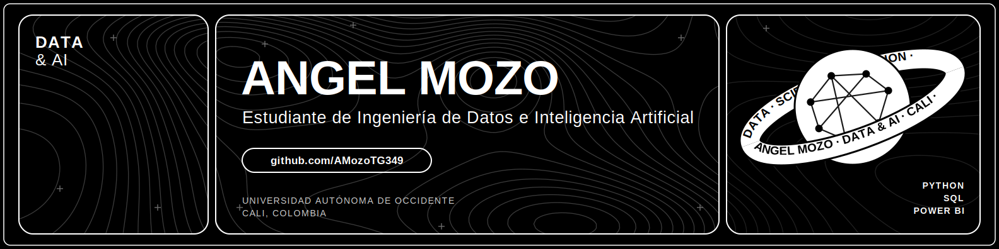

  

# Hola, soy Angel 👋

Estudiante de **Ingeniería de Datos e Inteligencia Artificial** en la Universidad Autónoma de Occidente (Cali, Colombia). Me interesa el análisis de datos, los modelos predictivos y construir soluciones con datos. Busco **prácticas en análisis de datos**.

## 🚀 Proyecto en proceso

Estoy trabajando en  un mentor deportivo con IA, API-first, que ayuda a deportistas de cualquier disciplina a entender el juego y mejorar su rendimiento a partir del conocimiento profundo del deporte: sus reglas, las jugadas reales y las decisiones tácticas. Estoy muy emocionado trabajando con el y espero realmente tenerlo muy pronto terminado!

## 📚 Aprendiendo ahora
- [Aprediendo a como utilizar correcta y eficientemente las inteligencias artificiales para automatizar procesos]
- [Recuperando mi nivel de ingles]
- [Redes e infraestructura en la universidad]

## 🛠️ Stack

## ⭐ Recomendación de la semana
<!-- RECOMENDACION:START -->
**A Silent Voice (Una voz silenciosa)** · Película de anime
Un chico intenta reparar el daño que le hizo a una compañera sorda en la escuela. · [Ver]()
<!-- RECOMENDACION:END -->

## 📫 Contacto
[LinkedIn]([https://www.linkedin.com/in/angel-mauricio-mozo-perez-172017389/]) · angel.mau.mozo@gmail.com
